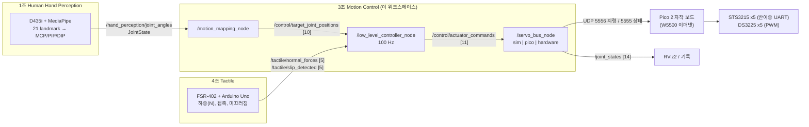

# ros2_ws: 3조 Motion Control ROS 2 워크스페이스

3조 프로젝트를 "ROS 를 사용하지 않는" 방향에서 **"ROS 를 사용하는"** 방향으로 다시 짠 워크스페이스입니다.
초기 테스트 베드(`robotic_hand_ws`, ROS 2 Humble)의 토픽 이름·주기·안전 규칙을 이어받고,
1조·4조 중간 보고서에 적힌 입출력에 맞춰 3조가 맡는 **Motion Mapping & Control** 부분을 구현했습니다.

## 1. 전체 흐름



## 2. 패키지

| 패키지 | 노드 | 역할 |
|---|---|---|
| `hand_motion_control` | `motion_mapping_node` | 1조 관절각(MCP, PIP, DIP) → 로봇 손 10 액추에이터 목표 관절각. PIP/DIP 는 텐던 커플링(θ_DIP = 0.8·θ_PIP) 직선에 최소제곱 투영 |
| | `low_level_controller_node` | 100 Hz 하위 제어기: 워치독(100 ms) → Tactile Latch(0.15 N, +1.4°) → 미끄러짐 반사 → 해제 인터락(텐던 슬랙 선행 → MCP 원복) → 속도 제한 → 서보 지령(텐던 horn 각 = L(θ)/r) |
| | `servo_bus_node` | `backend:=sim` 서보 1차 지연 모델 / **`backend:=pico`** Pico 2 자작 보드에 UDP 지령(실기 기본값) / `backend:=hardware` Pi 직결(STS3215 SYNC WRITE + PCA9685) |
| `firmware/pico2_servo_bridge` (레포 루트) | MicroPython | Pico 2 보드: W5500 UDP 수신 → UART·URT-2 로 STS3215 SYNC WRITE, PWM 으로 DS3225, 위치·부하 회신, 100 ms 워치독 ([README](../firmware/pico2_servo_bridge/README.md)) |
| `team_interface_mocks` | `mock_hand_perception_node` | 1조 출력 mock data (쥐었다 폈다 반복, 30 Hz) |
| | `mock_tactile_node` | 4조 출력 mock: 손가락 굴곡이 가상 물체에 닿으면 법선력 생성, 미끄러짐 주입 |
| | `tactile_serial_bridge_node` | 4조 Arduino Uno 시리얼(ADC 0~1023) → 전압 → 하중(N) → 접촉·미끄러짐 토픽 |

핵심 로직(`mapping.py`, `controller.py`, `kinematics.py`, `sts_protocol.py`, `pca9685.py`, `fsr.py`)은 ROS 없이 import 할 수 있고, 노드 파일은 그 위의 얇은 래퍼입니다.

## 3. 토픽 인터페이스

| 토픽 | 타입 | 주기 | 발행 → 구독 | 내용 |
|---|---|---|---|---|
| `/hand_perception/joint_angles` | `sensor_msgs/JointState` | 30 Hz | 1조 → 3조 | 이름 + 관절각(rad). 기본 이름 `thumb_mcp, thumb_ip, {index,middle,ring,pinky}_{mcp,pip,dip}` (config 에서 변경) |
| `/tactile/normal_forces` | `std_msgs/Float32MultiArray` [5] | 100 Hz | 4조 → 3조 | 엄지..새끼 법선력(N) |
| `/tactile/slip_detected` | `std_msgs/UInt8MultiArray` [5] | 이벤트/100 Hz | 4조 → 3조 | 미끄러짐 플래그 (테스트 베드 IF-05B 의 `slip_detected[5]`) |
| `/tactile/contact` | `std_msgs/UInt8MultiArray` [5] | 100 Hz | 4조 브릿지 | 접촉 여부 (참고용) |
| `/control/target_joint_positions` | `std_msgs/Float32MultiArray` [10] | 30 Hz | 매핑 → 제어기 | 10 액추에이터 목표 관절각(rad). 테스트 베드와 같은 이름 |
| `/control/actuator_commands` | `std_msgs/Float32MultiArray` [11] | 100 Hz | 제어기 → 서보 | 서보 각 10 + 토크 활성 플래그 |
| `/control/joint_position_command` | `std_msgs/Float32MultiArray` [14] | 100 Hz | 제어기 | 14 관절 지령 에코 (테스트 베드와 같은 이름) |
| `/control/state` | `std_msgs/String` | 변화 시 | 제어기 | `ok` / `watchdog` |
| `/hardware/servo_positions`, `/hardware/servo_load` | `std_msgs/Float32MultiArray` [10] | 100 Hz | 서보 | 측정 위치(rad), STS 부하 비율 |
| `/joint_states` | `sensor_msgs/JointState` [14] | 100 Hz | 서보 → RViz2 | 관절 이름 `joint_i_j` (기구학 문서 명명 규칙) |

배열 순서
- 10 액추에이터: `thumb_mcp, index_mcp, middle_mcp, ring_mcp, pinky_mcp, thumb_tendon, index_tendon, middle_tendon, ring_tendon, pinky_tendon`
  (2조 구조, 2026-11-03: 다섯 손가락 뿌리 관절은 STS3215 직접 구동, 나머지 관절은 DS3225 텐던. 엄지 텐던은 0-1 관절 하나)
- 14 관절: `joint_0_0, joint_0_1, joint_1_0, joint_1_1, joint_1_2, …, joint_4_2`
- 촉각 5: 엄지, 검지, 중지, 약지, 새끼

## 4. 실행

```bash
# Docker (테스트 베드와 같은 ROS 2 Humble 이미지)
docker build -t hand_ros2 ros2_ws
docker run -it --rm hand_ros2

# 또는 ROS 2 가 설치된 PC / Raspberry Pi 5
cd ros2_ws
colcon build --symlink-install
source install/setup.bash

# 하드웨어 없이 전체 파이프라인 (1조 mock → 매핑 → 제어기 → 서보 sim → 4조 mock)
ros2 launch hand_motion_control sim_bringup.launch.py
ros2 launch hand_motion_control sim_bringup.launch.py slip_period_s:=1.5   # 미끄러짐 반사 확인

# 실기: Pi 는 연산·통신, Pico 2 보드가 서보 구동 (hand_params.yaml 의 pico.ip 를 보드 IP 로)
ros2 launch hand_motion_control hardware_bringup.launch.py
ros2 launch hand_motion_control hardware_bringup.launch.py servo_backend:=hardware   # Pi 직결 대안
ros2 launch hand_motion_control hardware_bringup.launch.py use_mock_perception:=true use_tactile_bridge:=true
```

ROS 없이 로직만 검사:

```bash
pip install pytest
python -m pytest ros2_ws -q     # 19개
```

`test_nodes.py` 는 가짜 rclpy(`test_support/fake_ros.py`)로 노드 5개를 만들어 콜백을 직접 연결하고,
3초 동안 1조 mock → 매핑 → 제어기 → 서보 sim → 4조 mock 폐루프가 도는지 확인합니다.
실제 ROS 2 위에서의 `colcon build`·`ros2 launch` 는 이 환경에서 돌려보지 못했습니다.

## 5. 근거 대조

| 항목 | 값 | 출처 |
|---|---|---|
| MCP 직접 구동, PIP/DIP Tendon 구동 | STS3215-C018 12V 30kg, DS3225 25kg | 3조 중간보고서 |
| MCU | Raspberry Pi 5 4GB | 3조 중간보고서 |
| 텐던 길이 L(θ) | `kinematics.tendon_length()` (일정 반경 모델) | 3조 중간보고서 "굽힘각(θ)일 때 Tendon 의 길이(L)" — 논문 수식 확정 시 교체 |
| 입력: 관절 이름 + 각도 ROS2 topic | `/hand_perception/joint_angles` | 1조 중간보고서 3절 |
| mock data 로 개별 개발 후 D435i 검증 | `mock_hand_perception_node` | 1조 중간보고서 1·3절 |
| FSR-402, 분압 1 kΩ/10 kΩ, Arduino Uno, V → N, 2차 다항식 | `fsr.py`, `tactile_serial_bridge_node` | 4조 중간보고서 1.1 |
| 접촉 감지, 미끄러짐 감지, ROS2 통합 | `/tactile/*`, 미끄러짐 반사 | 4조 중간보고서 2.1~2.3 |
| 손가락별 마디 길이, 손바닥 외형, 손가락 배치 각도(엄지 50°, 약지·소지 8°) | `hand_spec.py` | 2조 중간보고서 (2026-10-01) 2·3절 |
| θ_DIP = 0.8·θ_PIP, 0 ≤ θ ≤ π/2, 손끝 수식 | `hand_spec.py`, `kinematics.py` | robotic_hand_ws/kinematics_dynamics_math_model.md, dh_parameters_report.md |
| 100 Hz, 워치독 100 ms, 모터 ID 1~10, 1 Mbps | `controller.py`, `hand_params.yaml` | robotic_hand_ws/SYSTEM_INTERFACE_CONTRACT.md (IF-02, IF-04, IF-05B) |
| Tactile Latch 0.15 N + 1.4°, 해제 시퀀스, ΔL = r_mcp·Δq_mcp, PCA9685 | `controller.py`, `kinematics.py`, `pca9685.py` | AI_Priority_Rules/10_SYSTEM_PIPELINE_ARCHITECTURE.md |
| STS3215 레지스터 40/42/56/58/60 | `sts_protocol.py`, `firmware/.../sts.py` | URT2_STS3215_RASPI_GUIDE.md |
| Pi 는 연산·통신, Pico 2 보드가 서보 구동(STS 는 URT-2 직결), W5500 이더넷 | `pico_link.py`, `PicoBackend`, `firmware/pico2_servo_bridge` | 사용자 설명 (2026-10-22) |
| UDP 5555 상태 / 5556 지령, 100 ms 워치독 | `pico_link.py`, 펌웨어 `config.py` | SYSTEM_INTERFACE_CONTRACT.md (IF-03, IF-04) |

## 6. 팀 간 합의·실측이 필요한 값

1. **1조**: JointState 관절 이름(기본값 위 표), 엄지 관절을 `thumb_mcp/thumb_ip` 로 줄지, 사람 손 → 로봇 손 `gain/offset`.
2. **4조**: Arduino 시리얼 한 줄 형식(제안: `a0,a1,a2,a3,a4`), 2차 다항식 계수(`fsr.poly`), 접촉 임계값, 미끄러짐 판단 기준. 지금 값은 모두 [추정].
3. **2조(기구)**: DIP/PIP 비율 — 기구학 문서 0.8, 레포 `v8/config.py` 0.88 로 서로 다름. 텐던 권선 반경 `r_mcp, r_pip, r_dip`, horn 반경 (2조 보고서에 없음). 마디 길이가 관절 축 간 거리인지. 약지·소지 8° 의 회전 방향. 엄지 텐던 DS3225 출력 핀 (보드에 다섯 번째 버퍼 없음, 펌웨어는 GP6 가정).
4. **3조 실측**: STS3215 영점(`zero_raw`)·방향, DS3225 펄스 범위·회전 범위(현재 500~2500 µs / 270° [추정]).
5. **Pico 2 보드**: W5500 SPI·UART·PWM 핀 번호 (`firmware/pico2_servo_bridge/config.py` 의 [확인 필요]). 받은 부품표(BOM)에는 핀 연결 정보가 없어 회로도가 필요합니다. IP 는 정해서 쓰는 값이며 방법은 펌웨어 README 의 "IP 설정과 확인".
6. **모터 ID**: 인터페이스 문서는 1~10, AI_Priority_Rules/10 배선도는 0~5. 기본값은 1~6 이며 `sts.ids` 로 바꿉니다.

## 7. 아직 하지 않은 것

- RL 정책(SAC + HER, `v8/`)을 ROS 노드로 올리는 일. 정책 출력이 `/control/target_joint_positions` 로 들어가면 같은 하위 제어기를 그대로 씁니다.
- MuJoCo 기반 시뮬레이션 노드. 지금 `sim` 백엔드는 서보 지연만 모델링하고 물체 접촉은 `mock_tactile_node` 의 가상 물체로 대신합니다.
- RViz2 용 URDF 관절 이름 맞추기 (`robotic_hand_ws/assets/models/aero_hand_open_right.urdf` 와 `joint_i_j` 대응).
